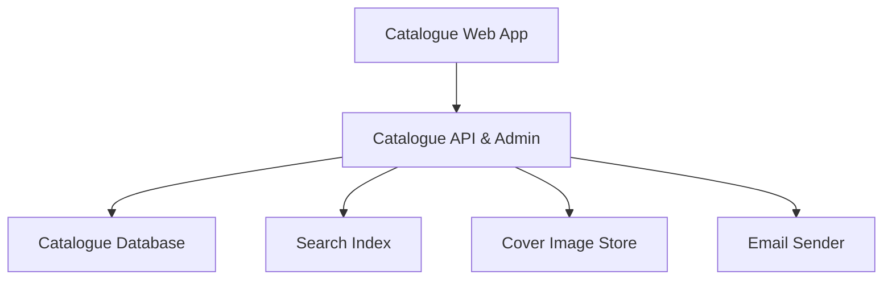
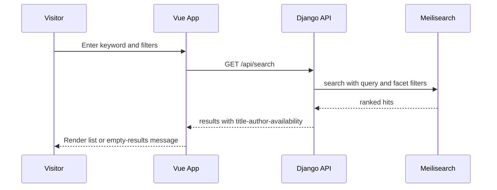
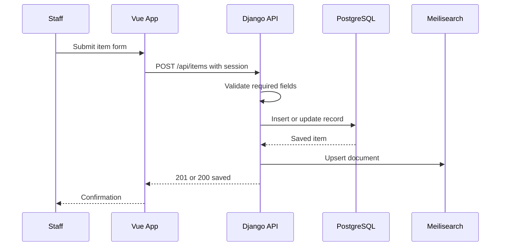
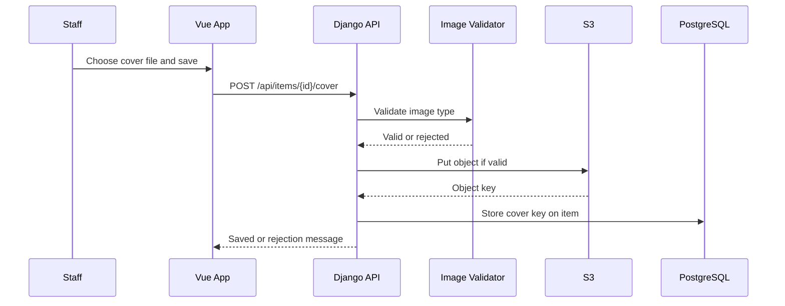
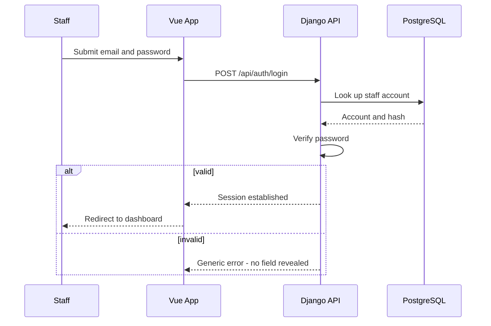
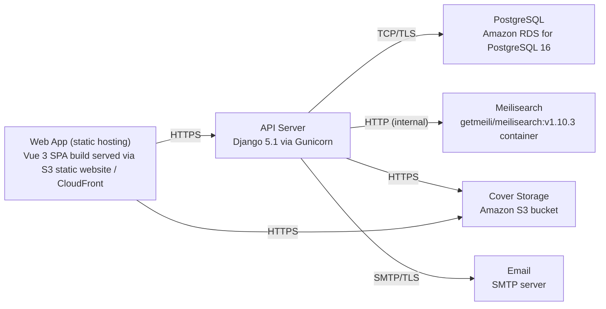

# Architecture

> Maintained by QuorQ AI SDLC. Text between `sdlc:auto` markers is regenerated; anything outside them is yours and is kept.

<!-- sdlc:auto:start narrative -->
## Overview

### ARCH-001 · approved · source: architecture:summary

Approved (v1) lightweight architecture: Vue 3 SPA + Django 5.1 REST API + PostgreSQL 16 + Meilisearch + S3 + SMTP, all on AWS.

Public users browse/search/view item details with no login. Staff authenticate (email/password) to a management dashboard to manually create/edit/delete records and manage cover images; every change is re-indexed into Meilisearch and covers are served from S3.

**Related:** EPIC-001, EPIC-002, EPIC-003, EPIC-004, EPIC-005

### ARCH-002 · approved · source: architecture:component:frontend

Catalogue Web App (Vue 3) -- responsive SPA for public pages and staff dashboard.

Single Vue 3 SPA serves public search/browse/detail pages plus the authenticated staff management dashboard, consuming the Django REST API. Deployed as a static build (S3 static website / CloudFront).

**Related:** EPIC-001, EPIC-002, EPIC-003, EPIC-004, EPIC-005

### ARCH-003 · approved · source: architecture:component:backend

Catalogue API & Admin (Django 5.1) -- REST API for search, item detail, staff auth and CRUD.

Validates cover uploads, writes records to PostgreSQL, pushes documents to Meilisearch, stores covers in S3, sends staff account emails via SMTP. Endpoints:
- GET /api/search -- public keyword search with author/subject/availability facets, ranked via Meilisearch.
- GET /api/items/{id} -- public item detail with cover URL or placeholder and read-only availability.
- GET /api/facets -- public distinct author/subject/availability values.
- POST /api/auth/login -- staff login, generic error on failure.
- POST /api/auth/logout -- ends staff session.
- POST /api/auth/password-reset -- sends password-reset email via SMTP.
- GET /api/items -- staff dashboard listing with search/filter.
- POST /api/items -- create item, validates required fields, upserts to Meilisearch.
- PUT /api/items/{id} -- edit item, changes reflected publicly and in search/filters.
- DELETE /api/items/{id} -- delete item after confirmation, removes from catalogue and index.
- POST /api/items/{id}/cover -- upload/replace cover, validates image type, stores in S3.
- DELETE /api/items/{id}/cover -- remove cover, falls back to placeholder.
Deployed via Gunicorn on Python 3.12, single AWS EC2 instance.

**Related:** EPIC-001, EPIC-003, EPIC-004, EPIC-005

### ARCH-004 · approved · source: architecture:component:database

Catalogue Database (PostgreSQL 16) -- system of record for items, staff accounts and availability.

Entities:
- staff_user: id, email, password_hash, is_active, last_login, created_at.
- item: id, title, author, isbn, publisher, publication_year, subject, description, shelf_location, availability_status, cover_image_key, created_by, created_at, updated_at.
Hosted as Amazon RDS for PostgreSQL 16, managed.

**Related:** EPIC-003, EPIC-004

### ARCH-005 · approved · source: architecture:component:search

Search Index (Meilisearch v1.10.3) -- typo-tolerant keyword search and faceted filtering.

Index of catalogue items providing typo-tolerant keyword search and author/subject/availability facets for both public search and the staff dashboard search. Runs as the getmeili/meilisearch:v1.10.3 container, deployed via Docker on the same API EC2 instance.

**Related:** EPIC-001, EPIC-004, NFR-004, NFR-005

### ARCH-006 · approved · source: architecture:component:object_storage

Cover Image Store (Amazon S3) -- stores and serves uploaded cover images.

S3 bucket stores uploaded cover images and serves them to public catalogue and detail pages. Managed object store, no server management needed.

**Related:** EPIC-005, NFR-003

### ARCH-007 · approved · source: architecture:component:email

Email Sender (SMTP server) -- delivers staff account-setup and password-reset emails.

External SMTP endpoint used for staff account-setup and password-reset emails; low volume, standard SMTP server sufficient (no paid email service needed).

**Related:** EPIC-003

### ARCH-008 · approved · source: architecture:critical_path:public_search

Critical path: public keyword search & filter.

Anonymous visitor submits a keyword and optional author/subject/availability filters; backend queries Meilisearch and returns ranked, typo-tolerant results with title, author and availability.

**Related:** US-001, US-002

### ARCH-009 · approved · source: architecture:critical_path:create_edit_reindex

Critical path: staff create/edit item with re-index.

Authenticated staff submit the item form; backend validates required fields, persists to PostgreSQL, and upserts the document into Meilisearch so it becomes publicly searchable immediately.

**Related:** US-006, US-007

### ARCH-010 · approved · source: architecture:critical_path:cover_upload

Critical path: cover image upload & validation.

Staff upload a cover image; backend validates it is a supported image, stores it in S3, links the key to the item; public pages render the cover or a placeholder.

**Related:** US-010, US-011

### ARCH-011 · approved · source: architecture:critical_path:staff_login

Critical path: staff login & management-area protection.

Staff authenticate with email/password; valid credentials open a session and the dashboard; invalid credentials return a generic error; unauthenticated access to management endpoints redirects to login.

**Related:** US-004, US-005

### ARCH-012 · approved · source: architecture:deployment_nodes

Deployment topology for the approved architecture.

- Web App: Vue 3 SPA build served via S3 static website / CloudFront (static assets).
- API Server: Django 5.1 via Gunicorn, Python 3.12, single AWS EC2 instance.
- PostgreSQL: Amazon RDS for PostgreSQL 16 (managed).
- Meilisearch: getmeili/meilisearch:v1.10.3 container, Docker on the API EC2 instance.
- Cover Storage: Amazon S3 bucket (managed object store).
- Email: external SMTP endpoint.

### ARCH-013 · approved · source: architecture:tech_decision:frontend

Frontend technology decision: Vue 3 (alternatives considered: React, Svelte).

Chosen to deliver the responsive public search/browse/detail pages and staff dashboard as a single SPA consuming the Django REST API, satisfying NFR-006 (responsive desktop/mobile web).

**Related:** NFR-006

### ARCH-014 · approved · source: architecture:tech_decision:backend

Backend technology decision: Django 5.1 (alternatives considered: FastAPI, Express).

Chosen for the REST API, built-in auth/session handling for staff login, an admin-grade ORM for item records, and clean integration points for Meilisearch and S3.

### ARCH-015 · approved · source: architecture:tech_decision:database

Database technology decision: PostgreSQL 16 (alternatives considered: MySQL, SQLite).

Chosen as the reliable relational store for ~10,000 structured bibliographic records and staff accounts, and as the source of truth feeding the Meilisearch index (NFR-004).

**Related:** NFR-004

### ARCH-016 · approved · source: architecture:tech_decision:cloud

Cloud technology decision: AWS (alternatives considered: GCP, Azure).

Chosen to host the API server, managed PostgreSQL database and S3 cover-image storage in one place, keeping cost low for a mostly-idle single-library workload.
<!-- sdlc:auto:end narrative -->

<!-- sdlc:auto:start building-blocks -->
## Building Block View

| ID | Name | Technology | Responsibility | Depends on |
|---|---|---|---|---|
| frontend | Catalogue Web App | Vue 3 | Responsive Vue 3 SPA serving the public search/browse/detail pages and the authenticated staff management dashboard; calls the backend REST API. | backend |
| backend | Catalogue API & Admin | Django 5.1 | Django 5.1 application exposing REST endpoints for search, item detail, staff auth and CRUD; validates cover uploads, writes records to PostgreSQL, pushes documents to Meilisearch and stores covers in S3; sends staff account emails via SMTP. | database, search, object_storage, email |
| database | Catalogue Database | PostgreSQL 16 | PostgreSQL 16 system of record holding item records, staff accounts and availability status; source of truth for all edits. | — |
| search | Search Index | Meilisearch v1.10.3 (getmeili/meilisearch:v1.10.3) | Meilisearch index of catalogue items providing typo-tolerant keyword search and author/subject/availability faceted filtering for public and dashboard search. | — |
| object_storage | Cover Image Store | Amazon S3 | Amazon S3 bucket storing uploaded cover images and serving them to public catalogue and detail pages. | — |
| email | Email Sender | SMTP server | SMTP server used to deliver staff account-setup and password-reset emails. | — |

<!-- sdlc:auto:end building-blocks -->

<!-- sdlc:auto:start runtime -->
## Runtime View

### Public keyword search & filter

Anonymous visitor submits a keyword and optional author/subject/availability filters; the backend queries Meilisearch and returns ranked, typo-tolerant results with title, author and availability.

- **Components:** frontend, backend, search
- **Modules:** search_views, meili_client, serializers
- **Key functions:** search_items(query, filters, page), build_meili_filter(author, subject, availability), serialize_result(hit)

### Staff create/edit item with re-index

Authenticated staff submit the item form; the backend validates required fields, persists to PostgreSQL, and upserts the document into Meilisearch so it becomes publicly searchable.

- **Components:** frontend, backend, database, search
- **Modules:** item_views, item_models, meili_client, serializers
- **Key functions:** create_item(payload), update_item(id, payload), validate_required(payload), index_item(item)

### Cover image upload & validation

Staff upload a cover image; the backend validates it is a supported image, stores it in S3, links the key to the item, and the public pages render the cover or a placeholder.

- **Components:** frontend, backend, object_storage, database
- **Modules:** cover_views, image_validator, s3_storage, item_models
- **Key functions:** validate_image(file), store_cover(item_id, file), remove_cover(item_id)

### Staff login & management-area protection

Staff authenticate with email/password; valid credentials open a session and the dashboard; invalid credentials return a generic error; unauthenticated access to management endpoints is redirected to login.

- **Components:** frontend, backend, database
- **Modules:** auth_views, staff_models, permissions
- **Key functions:** login(email, password), logout(session), require_staff(request)

<!-- sdlc:auto:end runtime -->

<!-- sdlc:auto:start deployment-view -->
## Deployment View

| Name | Service | Runtime | Scaling | Environment |
|---|---|---|---|---|
| Web App (static hosting) | Vue 3 SPA build served via S3 static website / CloudFront | Static assets | CDN-cached, effectively unlimited | dev |
| API Server | Django 5.1 via Gunicorn | Python 3.12 on a single AWS EC2 instance | Single modest instance; vertical scale if needed | dev |
| PostgreSQL | Amazon RDS for PostgreSQL 16 | Managed PostgreSQL 16 | Single db.t-class instance, encryption at rest enabled | dev |
| Meilisearch | getmeili/meilisearch:v1.10.3 container | Docker on the API EC2 instance | Single container sized for ~10,000 documents | dev |
| Cover Storage | Amazon S3 bucket | Managed object store | Elastic | dev |
| Email | SMTP server | External SMTP endpoint | Low volume | dev |

| Source | Target | Protocol |
|---|---|---|
| Web App (static hosting) | API Server | HTTPS |
| API Server | PostgreSQL | TCP/TLS |
| API Server | Meilisearch | HTTP (internal) |
| API Server | Cover Storage | HTTPS |
| API Server | Email | SMTP/TLS |
| Web App (static hosting) | Cover Storage | HTTPS |

<!-- sdlc:auto:end deployment-view -->

<!-- sdlc:auto:start decisions -->
## Architecture Decisions

| Layer | Choice | ADR |
|---|---|---|
| Frontend | Vue 3 | [ADR-0001](adr/frontend.md) |
| Backend | Django 5.1 | [ADR-0002](adr/backend.md) |
| Database | PostgreSQL 16 | [ADR-0003](adr/database.md) |
| Cloud | AWS | [ADR-0004](adr/cloud.md) |
<!-- sdlc:auto:end decisions -->

<!-- sdlc:auto:start links -->
## Related Documents

- [Data Model](data-model.md)
- [API Specification](api/openapi.yaml)
- [Architecture Decision Records](adr/README.md)
<!-- sdlc:auto:end links -->
