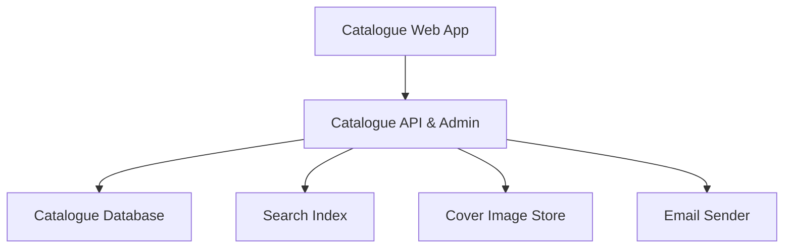
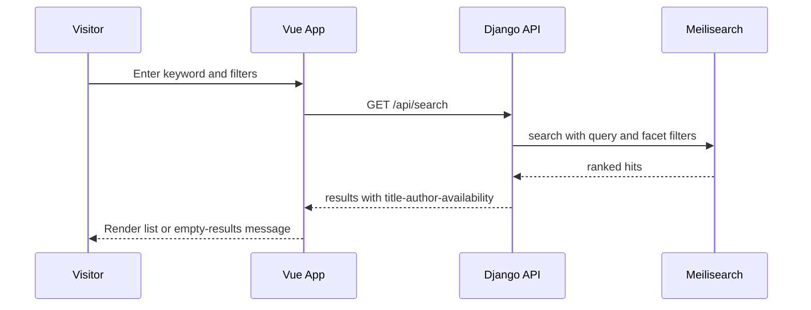
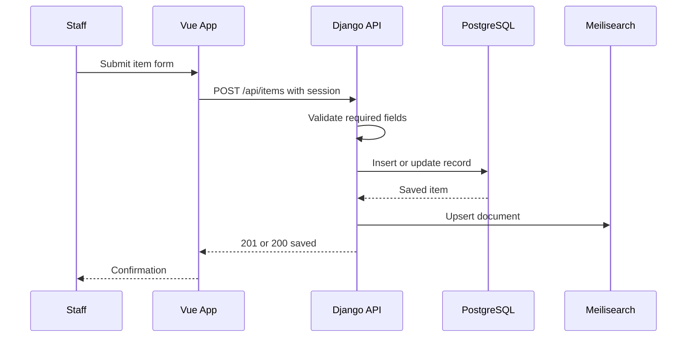
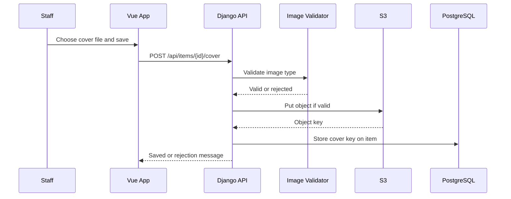
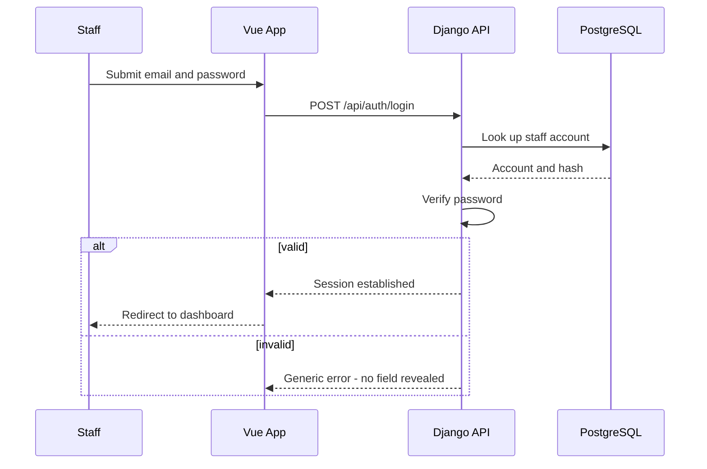
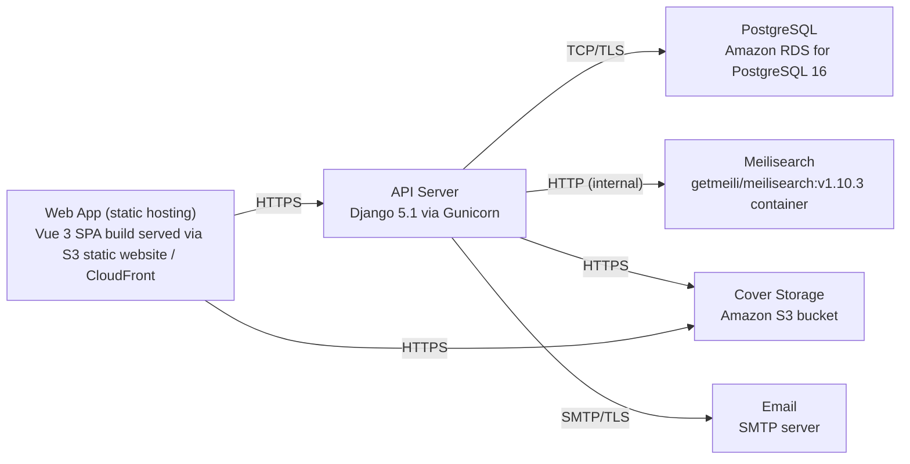

# Architecture

> Maintained by QuorQ AI SDLC. Text between `sdlc:auto` markers is regenerated; anything outside them is yours and is kept.

<!-- sdlc:auto:start narrative -->
## Overview

### ARCH-OVERVIEW · approved · source: architecture:summary

Approved v1 architecture for a lightweight public library catalogue: Vue 3 SPA frontend, Django 5.1 REST backend, PostgreSQL 16 as system of record for ~10,000 bibliographic records, Meilisearch for typo-tolerant search and faceted filtering, Amazon S3 for cover images, and SMTP for staff account emails, all hosted on AWS.

The public can browse, search and view item detail pages without logging in. Library staff authenticate with email/password to a management dashboard where they manually create, edit and delete item records and upload cover images. Every staff change is re-indexed into Meilisearch and cover images are served from S3. Architecture status is 'approved', version 1.

- ⚠ Overview does not state which of US-001..US-011 each architectural capability satisfies; mapping must come from the requirements phase.

### ARCH-COMP-FRONTEND · approved · source: architecture:components.frontend

Catalogue Web App is a responsive Vue 3 single-page application serving both the public search/browse/detail pages and the authenticated staff management dashboard.

Component type: frontend. Technology: Vue 3. Responsibilities: render public search, browse and item-detail pages; render the staff management dashboard; call the backend REST API for all data operations (search, item CRUD, auth, cover upload).

- ⚠ No explicit requirement id(s) attached to this component in the architecture input.

### ARCH-COMP-BACKEND · approved · source: architecture:components.backend

Catalogue API & Admin is the Django 5.1 application exposing REST endpoints for search, item detail, staff auth and item CRUD.

Component type: backend. Technology: Django 5.1. Responsibilities: validate cover image uploads; write records to PostgreSQL; push documents to Meilisearch on changes; store cover images in S3; send staff account/password-reset emails via SMTP.

- ⚠ No explicit requirement id(s) attached to this component in the architecture input.

### ARCH-COMP-DATABASE · approved · source: architecture:components.database

Catalogue Database is PostgreSQL 16, the system of record for item records, staff accounts and availability status.

Component type: database. Technology: PostgreSQL 16. Role: source of truth for all edits; feeds the Meilisearch index whenever records change.

- ⚠ No explicit requirement id(s) attached to this component in the architecture input.

### ARCH-COMP-SEARCH · approved · source: architecture:components.search

Search Index is a Meilisearch v1.10.3 index of catalogue items providing typo-tolerant keyword search and faceted filtering by author/subject/availability.

Component type: search. Technology: Meilisearch v1.10.3 (image getmeili/meilisearch:v1.10.3). Serves both public search/browse and dashboard search. Index is kept in sync via upserts from the backend on item create/edit/delete.

- ⚠ No explicit requirement id(s) attached to this component in the architecture input.

### ARCH-COMP-STORAGE · approved · source: architecture:components.object_storage

Cover Image Store is an Amazon S3 bucket storing uploaded cover images and serving them to public catalogue and detail pages.

Component type: object_storage. Technology: Amazon S3. Stores cover images keyed and linked to item records; public pages render the cover from S3 or fall back to a placeholder if absent.

- ⚠ No explicit requirement id(s) attached to this component in the architecture input.

### ARCH-COMP-EMAIL · approved · source: architecture:components.email

Email Sender is an SMTP server used to deliver staff account-setup and password-reset emails.

Component type: email. Technology: SMTP server (external). Used exclusively for staff-facing account/password-reset email delivery; no public-facing email functionality is described.

- ⚠ No explicit requirement id(s) attached to this component in the architecture input.
- ⚠ Specific SMTP provider/configuration not specified.

### ARCH-FLOW-SEARCH · approved · source: architecture:critical_paths.Public keyword search & filter

Critical path for anonymous public search and filtering through Meilisearch.

An anonymous visitor submits a keyword and optional author/subject/availability filters. The backend (Django) queries Meilisearch and returns ranked, typo-tolerant results including title, author and availability. Implemented via GET /api/search and GET /api/facets.

- ⚠ Not mapped to a specific US- requirement id in the architecture input.

### ARCH-FLOW-CREATE-EDIT · approved · source: architecture:critical_paths.Staff create/edit item with re-index

Critical path for authenticated staff creating or editing an item record, with automatic search re-indexing.

Authenticated staff submit the item form. The backend validates required fields, persists the record to PostgreSQL, and upserts the corresponding document into Meilisearch so the change becomes publicly searchable immediately. Implemented via POST /api/items and PUT /api/items/{id}.

- ⚠ Not mapped to a specific US- requirement id in the architecture input.

### ARCH-FLOW-COVER-UPLOAD · approved · source: architecture:critical_paths.Cover image upload & validation

Critical path for staff uploading and validating a cover image.

Staff upload a cover image; the backend validates it is a supported image format, stores it in S3, and links the resulting key to the item record. Public pages render the cover image or a placeholder if none is linked. Implemented via POST /api/items/{id}/cover and DELETE /api/items/{id}/cover.

- ⚠ Not mapped to a specific US- requirement id in the architecture input.
- ⚠ Supported image formats/size limits are not specified.

### ARCH-FLOW-LOGIN · approved · source: architecture:critical_paths.Staff login & management-area protection

Critical path for staff authentication and protection of the management dashboard.

Staff authenticate with email and password. Valid credentials open a session and grant access to the dashboard. Invalid credentials return a generic error (not revealing which field was wrong). Unauthenticated access to management endpoints is redirected to login. Implemented via POST /api/auth/login, POST /api/auth/logout and POST /api/auth/password-reset.

- ⚠ Not mapped to a specific US- requirement id in the architecture input.

### ARCH-DATA-MODEL · approved · source: architecture:entities

Two core data entities are defined: staff_user and item.

staff_user: id, email, password_hash, is_active, last_login, created_at -- backs staff authentication and account management. item: id, title, author, isbn, publisher, publication_year, subject, description, shelf_location, availability_status, cover_image_key, created_by, created_at, updated_at -- the full bibliographic record stored in PostgreSQL and mirrored (minus internal-only fields as applicable) into Meilisearch.

- ⚠ No explicit requirement id(s) attached to these entities in the architecture input.
- ⚠ Field-level validation rules (e.g. ISBN format, required vs optional fields) are not specified at the entity level.

### ARCH-API · approved · source: architecture:endpoints

REST API surface exposed by the Django backend, split between public (unauthenticated) and staff (authenticated) endpoints.

Public endpoints: 1) GET /api/search -- keyword search with optional author/subject/availability filters, ranked via Meilisearch. 2) GET /api/items/{id} -- item detail with full bibliographic fields, cover URL or placeholder, and read-only availability. 3) GET /api/facets -- distinct author/subject/availability values for browse filters. Auth endpoints: 4) POST /api/auth/login -- staff login, generic error on failure. 5) POST /api/auth/logout -- ends staff session. 6) POST /api/auth/password-reset -- requests a password-reset email via SMTP. Staff management endpoints: 7) GET /api/items -- dashboard listing with search/filter to locate a record. 8) POST /api/items -- create an item; validates required fields and upserts to Meilisearch. 9) PUT /api/items/{id} -- edit an item; changes reflected in public detail, search and filters. 10) DELETE /api/items/{id} -- delete an item after staff confirmation; removed from catalogue and search index. 11) POST /api/items/{id}/cover -- upload/replace cover image; validates supported image type, stores in S3. 12) DELETE /api/items/{id}/cover -- remove cover image, item falls back to placeholder.

- ⚠ No explicit requirement id(s) attached to individual endpoints in the architecture input.
- ⚠ Request/response payload schemas and pagination details for list endpoints are not specified.

### ARCH-DEPLOYMENT · approved · source: architecture:deployment_nodes

Single-environment AWS deployment: static SPA hosting, one API EC2 instance running both Django and Meilisearch, managed RDS Postgres, S3, and external SMTP.

Nodes: Web App -- Vue 3 SPA build served as static assets via S3 static website / CloudFront. API Server -- Django 5.1 via Gunicorn on Python 3.12, on a single AWS EC2 instance. PostgreSQL -- Amazon RDS for PostgreSQL 16 (managed). Meilisearch -- getmeili/meilisearch:v1.10.3 container running via Docker on the same API EC2 instance. Cover Storage -- Amazon S3 bucket (managed object store). Email -- external SMTP endpoint.

- ⚠ Meilisearch and the Django API share a single EC2 instance with no redundancy or failover described; this single point of failure is not addressed as a decision or accepted risk in the input.
- ⚠ No explicit requirement id(s) attached to the deployment topology.

### ARCH-TECH-DECISIONS · approved · source: architecture:technology_decisions

Four key technology decisions were made: Vue 3 for frontend, Django 5.1 for backend, PostgreSQL 16 for the database, and AWS for cloud hosting, each with alternatives considered.

Frontend: Vue 3 chosen over React/Svelte to deliver the responsive public pages and staff dashboard as a single SPA consuming the Django REST API (cited as addressing NFR-006). Backend: Django 5.1 chosen over FastAPI/Express for built-in auth/session handling, an admin-grade ORM, and clean integration points for Meilisearch and S3. Database: PostgreSQL 16 chosen over MySQL/SQLite as a reliable relational store for ~10,000 structured records and staff accounts, and as the source of truth feeding Meilisearch (cited as addressing NFR-004). Cloud: AWS chosen over GCP/Azure to host the API server, managed PostgreSQL, and S3 cover storage together, keeping cost low for a mostly-idle single-library workload.

- ⚠ Technology decisions cite NFR-004 and NFR-006, but the known requirement keys for this project are only US-001 through US-011 -- these NFR ids are not resolvable against the given requirement set and should be confirmed/reconciled with the requirements phase.
<!-- sdlc:auto:end narrative -->

<!-- sdlc:auto:start building-blocks -->
## Building Block View

| ID | Name | Technology | Responsibility | Depends on |
|---|---|---|---|---|
| frontend | Catalogue Web App | Vue 3 | Responsive Vue 3 SPA serving the public search/browse/detail pages and the authenticated staff management dashboard; calls the backend REST API. | backend |
| backend | Catalogue API & Admin | Django 5.1 | Django 5.1 application exposing REST endpoints for search, item detail, staff auth and CRUD; validates cover uploads, writes records to PostgreSQL, pushes documents to Meilisearch and stores covers in S3; sends staff account emails via SMTP. | database, search, object_storage, email |
| database | Catalogue Database | PostgreSQL 16 | PostgreSQL 16 system of record holding item records, staff accounts and availability status; source of truth for all edits. | — |
| search | Search Index | Meilisearch v1.10.3 (getmeili/meilisearch:v1.10.3) | Meilisearch index of catalogue items providing typo-tolerant keyword search and author/subject/availability faceted filtering for public and dashboard search. | — |
| object_storage | Cover Image Store | Amazon S3 | Amazon S3 bucket storing uploaded cover images and serving them to public catalogue and detail pages. | — |
| email | Email Sender | SMTP server | SMTP server used to deliver staff account-setup and password-reset emails. | — |

<!-- sdlc:auto:end building-blocks -->

<!-- sdlc:auto:start runtime -->
## Runtime View

### Public keyword search & filter

Anonymous visitor submits a keyword and optional author/subject/availability filters; the backend queries Meilisearch and returns ranked, typo-tolerant results with title, author and availability.

- **Components:** frontend, backend, search
- **Modules:** search_views, meili_client, serializers
- **Key functions:** search_items(query, filters, page), build_meili_filter(author, subject, availability), serialize_result(hit)

### Staff create/edit item with re-index

Authenticated staff submit the item form; the backend validates required fields, persists to PostgreSQL, and upserts the document into Meilisearch so it becomes publicly searchable.

- **Components:** frontend, backend, database, search
- **Modules:** item_views, item_models, meili_client, serializers
- **Key functions:** create_item(payload), update_item(id, payload), validate_required(payload), index_item(item)

### Cover image upload & validation

Staff upload a cover image; the backend validates it is a supported image, stores it in S3, links the key to the item, and the public pages render the cover or a placeholder.

- **Components:** frontend, backend, object_storage, database
- **Modules:** cover_views, image_validator, s3_storage, item_models
- **Key functions:** validate_image(file), store_cover(item_id, file), remove_cover(item_id)

### Staff login & management-area protection

Staff authenticate with email/password; valid credentials open a session and the dashboard; invalid credentials return a generic error; unauthenticated access to management endpoints is redirected to login.

- **Components:** frontend, backend, database
- **Modules:** auth_views, staff_models, permissions
- **Key functions:** login(email, password), logout(session), require_staff(request)

<!-- sdlc:auto:end runtime -->

<!-- sdlc:auto:start deployment-view -->
## Deployment View

| Name | Service | Runtime | Scaling | Environment |
|---|---|---|---|---|
| Web App (static hosting) | Vue 3 SPA build served via S3 static website / CloudFront | Static assets | CDN-cached, effectively unlimited | dev |
| API Server | Django 5.1 via Gunicorn | Python 3.12 on a single AWS EC2 instance | Single modest instance; vertical scale if needed | dev |
| PostgreSQL | Amazon RDS for PostgreSQL 16 | Managed PostgreSQL 16 | Single db.t-class instance, encryption at rest enabled | dev |
| Meilisearch | getmeili/meilisearch:v1.10.3 container | Docker on the API EC2 instance | Single container sized for ~10,000 documents | dev |
| Cover Storage | Amazon S3 bucket | Managed object store | Elastic | dev |
| Email | SMTP server | External SMTP endpoint | Low volume | dev |

| Source | Target | Protocol |
|---|---|---|
| Web App (static hosting) | API Server | HTTPS |
| API Server | PostgreSQL | TCP/TLS |
| API Server | Meilisearch | HTTP (internal) |
| API Server | Cover Storage | HTTPS |
| API Server | Email | SMTP/TLS |
| Web App (static hosting) | Cover Storage | HTTPS |

<!-- sdlc:auto:end deployment-view -->

<!-- sdlc:auto:start decisions -->
## Architecture Decisions

| Layer | Choice | ADR |
|---|---|---|
| Frontend | Vue 3 | [ADR-0001](adr/frontend.md) |
| Backend | Django 5.1 | [ADR-0002](adr/backend.md) |
| Database | PostgreSQL 16 | [ADR-0003](adr/database.md) |
| Cloud | AWS | [ADR-0004](adr/cloud.md) |
<!-- sdlc:auto:end decisions -->

<!-- sdlc:auto:start links -->
## Related Documents

- [Data Model](data-model.md)
- [API Specification](api/openapi.yaml)
- [Architecture Decision Records](adr/README.md)
<!-- sdlc:auto:end links -->
