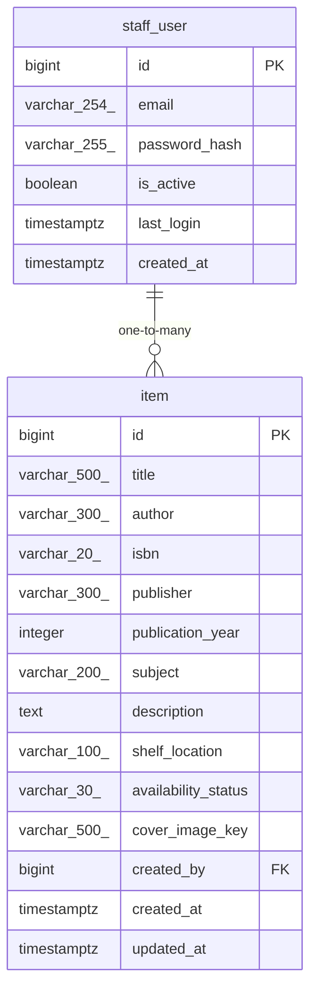

# Data Model

<!-- sdlc:auto:start entities -->
### staff_user

| Field | Type | PK | FK | Nullable |
|---|---|---|---|---|
| id | bigint | True | — | False |
| email | varchar(254) | False | — | False |
| password_hash | varchar(255) | False | — | False |
| is_active | boolean | False | — | False |
| last_login | timestamptz | False | — | True |
| created_at | timestamptz | False | — | False |

### item

| Field | Type | PK | FK | Nullable |
|---|---|---|---|---|
| id | bigint | True | — | False |
| title | varchar(500) | False | — | False |
| author | varchar(300) | False | — | False |
| isbn | varchar(20) | False | — | True |
| publisher | varchar(300) | False | — | True |
| publication_year | integer | False | — | True |
| subject | varchar(200) | False | — | True |
| description | text | False | — | True |
| shelf_location | varchar(100) | False | — | True |
| availability_status | varchar(30) | False | — | False |
| cover_image_key | varchar(500) | False | — | True |
| created_by | bigint | False | staff_user.id | True |
| created_at | timestamptz | False | — | False |
| updated_at | timestamptz | False | — | False |
<!-- sdlc:auto:end entities -->

<!-- sdlc:auto:start relationships -->
| Source | Target | Type |
|---|---|---|
| staff_user | item | one-to-many |
<!-- sdlc:auto:end relationships -->

<!-- sdlc:auto:start er-diagram -->

<!-- sdlc:auto:end er-diagram -->
