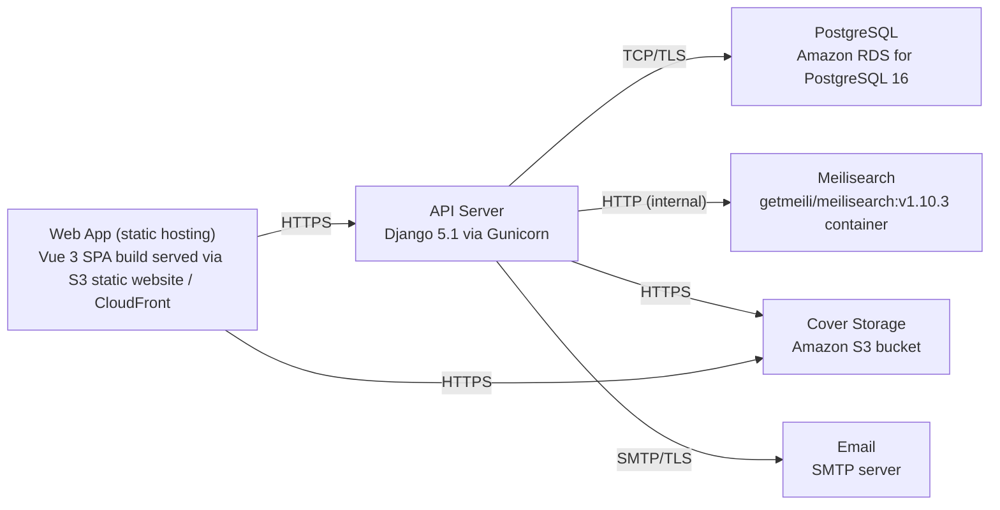

# Deployment Guide

> Maintained by QuorQ AI SDLC. Text between `sdlc:auto` markers is regenerated; anything outside them is yours and is kept.

<!-- sdlc:auto:start how-it-deploys -->
Pushes to `main` run `.github/workflows/deploy.yml`, which builds the API image (if there is a backend) and deploys the SPA to AWS Amplify. Commits touching only `docs/sdlc/**` don't deploy. Deployments can also be started from the platform's Deployment tab.
<!-- sdlc:auto:end how-it-deploys -->

<!-- sdlc:auto:start environments -->
| Name | Service | Runtime | Scaling | Environment |
|---|---|---|---|---|
| Web App (static hosting) | Vue 3 SPA build served via S3 static website / CloudFront | Static assets | CDN-cached, effectively unlimited | dev |
| API Server | Django 5.1 via Gunicorn | Python 3.12 on a single AWS EC2 instance | Single modest instance; vertical scale if needed | dev |
| PostgreSQL | Amazon RDS for PostgreSQL 16 | Managed PostgreSQL 16 | Single db.t-class instance, encryption at rest enabled | dev |
| Meilisearch | getmeili/meilisearch:v1.10.3 container | Docker on the API EC2 instance | Single container sized for ~10,000 documents | dev |
| Cover Storage | Amazon S3 bucket | Managed object store | Elastic | dev |
| Email | SMTP server | External SMTP endpoint | Low volume | dev |
<!-- sdlc:auto:end environments -->

<!-- sdlc:auto:start live -->
_Not deployed yet._
<!-- sdlc:auto:end live -->

<!-- sdlc:auto:start topology -->

<!-- sdlc:auto:end topology -->
